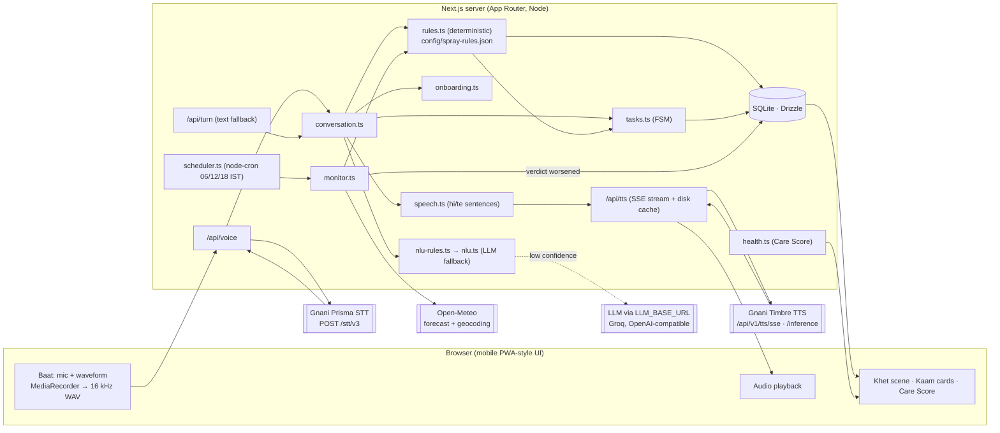

# Khet Saathi: Architecture (1 page)

**Principle:** speech in and speech out go through Gnani. Everything in between is code we own, and the part that makes the decision is **deterministic**. The LLM interprets what the farmer meant and phrases replies. It never decides the weather verdict or computes a date.

## 1. Voice turn

1. **Mic.** The Baat tab records with `MediaRecorder` and a live `AnalyserNode` waveform, then encodes 16 kHz mono WAV in the browser (`lib/client/wav.ts`).
2. **`POST /api/voice`.** The route is rate-limited and size-capped. It calls **Gnani Prisma** (`lib/gnani.ts`, `language_code hi-IN,en-IN` or `te-IN,en-IN`, `format=codemix`).
3. **Intent.** `nlu-rules.ts` parses the transcript first: fast, offline and tested. If its confidence is below 0.8, `nlu.ts` asks the LLM for a zod-validated `Intent` (kind, taskType, *verbatim* date phrase, notes, askTopic). If the LLM fails, the rule-based result is used.
4. **Action.** `conversation.ts` handles the turn. Before onboarding is done, the turn goes to `onboarding.ts`. After that, the date phrase is resolved in IST (`lib/time.ts`), the task is created or moved through the **task FSM**, the **rules engine** evaluates it against the forecast, and the result is persisted to SQLite.
5. **Reply text.** `speech.ts` builds the Hindi or Telugu sentence from rules output and stored data. Grounded answers to questions use the LLM only to phrase facts it's given.
6. **Voice.** The client calls `GET /api/tts`. On a cache hit the audio comes from disk. On a miss, the **Gnani Timbre** SSE stream is piped through so playback starts on the first chunk, and the REST `/inference` call is the fallback. The finished audio is cached by (model, voice, language, speed, text).

`/api/turn` runs the same flow from step 3 with typed text (text fallback and example chips).

## 2. Monitor and scheduler

- `instrumentation.ts` starts `scheduler.ts` once per server process. node-cron fires at `MONITOR_TIMES` (IST).
- Each fire creates the run key `YYYY-MM-DD@HH:MM`, and `scheduler_runs` rejects duplicate keys. That makes it **idempotent** across restarts, double registration, or several instances sharing one DB. A missed slot is run once on boot.
- `monitor.ts` gets the Open-Meteo forecast (cached with `fetched_at`; on failure it returns the cache marked stale, never invented values). It applies the DEMO_MODE overlay only if `DEMO_MODE=1` and a scenario is set. Then it evaluates every pre-start task:
  - `GO`: `planned/skip_suggested → go_ahead`
  - `WAIT` or `SKIP_TODAY`: `→ skip_suggested`, plus an **alert**. Alerts are unique by `dedupe_key` (task + verdict signature), so the same warning is never created twice.
  - `UNKNOWN` (no forecast for that day): no verdict change. The engine won't guess.
- Alerts appear as a banner and are spoken in the next app-open briefing (`/api/briefing`), then marked spoken/acknowledged.
- `POST /api/monitor` runs the same job on demand, for the manual refresh button or an external cron when `SCHEDULER_ENABLED=0`.

**Task FSM** (`lib/tasks.ts`): `planned → go_ahead | skip_suggested → in_progress → done`, and any active task can go to `postponed | cancelled`. `RESCHEDULE(date)` returns a task to `planned` for re-evaluation. `done` and `cancelled` are terminal. Every transition is appended to `history`.

**Rules engine** (`lib/rules.ts`): pure functions over hourly points within the configured day window (06–19 IST, 6 h task window). Spray rules check rain probability and amount, wind and gusts, heat, thunder codes and a humidity fungal-risk flag. Fertilize, irrigate and harvest each have their own rules. The output includes the verdict, machine-readable `reasons[]` (value, threshold, unit, hour), a suggested better window, `dataSource` and `dataFetchedAt`.

## 3. Data model (SQLite, `lib/db/schema.ts`)

| Table | Key fields |
|---|---|
| `farmers` | language, crop, sowing_date / expected_harvest, land_size + unit, place label, lat/lon, irrigation, confirmed_at |
| `tasks` | type, planned_date (IST date key), part_of_day, notes, **status**, last_verdict, last_evaluation (JSON), label (JSON, for label reading), history (JSON), started_at, completed_at |
| `alerts` | task_id, kind, verdict, message, **dedupe_key (unique)**, evaluation, spoken_at, ack_at |
| `weather_cache` | key (lat/lon), fetched_at, payload |
| `scheduler_runs` | **run_key (PK)**, status, summary |
| `timeline` | crop timeline events (task done, irrigation logged, onboarding…) |
| `messages` | chat history (role, text, meta) |
| `settings` | onboarding state, demo scenario, misc |

## Assumptions and decisions

- One farmer per instance, with no auth (hackathon scope). Timezone is always `Asia/Kolkata`.
- Languages: Hindi/Hinglish is primary and Telugu is supported. Both are in Prisma *and* Timbre.
- Crops: wheat, rice and onion. The stage tables are placeholders flagged for ICAR/KVK verification.
- Gnani calls are queued one at a time per service, because accounts may allow only one concurrent request.
- In progress: 48 h time scrubber; medicine label reading (vision LLM, printed text only, with a confirm step).
